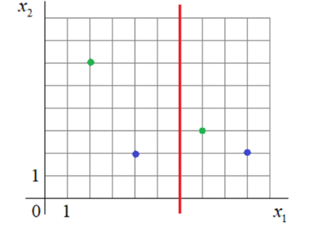

# Лабораторная работа № 2

**Расчет коэффициентов разделяющей линии и вычисление отступа (margin) для объектов разных классов**

Вариант: 7

Студент: ____________________

Группа: ____________________

---

## Исходные данные

По графику (сторона клетки = 1):

| Точка | Цвет | Класс y | x₁ | x₂ |
|---|---|---|---|---|
| x₁ | зеленая | +1 | 2 | 6 |
| x₂ | зеленая | +1 | 7 | 3 |
| x₃ | синяя | −1 | 4 | 2 |
| x₄ | синяя | −1 | 9 | 2 |

Разделяющая линия (красная) — вертикальная прямая, проходящая через x₁ = 6.

## 1. Расчет весов разделяющей линии

Уравнение линии: ω₁·x₁ + ω₂·x₂ + ω₀ = 0.

Прямая вертикальная, т.е. не зависит от x₂, значит ω₂ = 0. Тогда
ω₁·x₁ + ω₀ = 0 → x₁ = −ω₀/ω₁ = 6.

Этому условию удовлетворяет любой набор вида ω₁ = k, ω₀ = −6k. Знак k выбирается
из условия на отступы (п. 2): для точек, расположенных дальше от линии, отступ должен
быть положительным, для расположенных ближе — отрицательным.

Расстояния до линии: |x₁ − 6|:

| Точка | Сторона | Расстояние | Относительно линии |
|---|---|---|---|
| (2; 6) зеленая | слева | 4 | дальше (слева синяя на расстоянии 2) |
| (4; 2) синяя | слева | 2 | ближе |
| (7; 3) зеленая | справа | 1 | ближе (справа синяя на расстоянии 3) |
| (9; 2) синяя | справа | 3 | дальше |

Для зеленой точки (2; 6): M = (+1)·(k·2 − 6k) = −4k > 0 ⇒ k < 0. Берем k = −1:

**ω₀ = 6, ω₁ = −1, ω₂ = 0**, уравнение линии: −x₁ + 6 = 0.

Вектор весов (с учетом фиктивного признака x₀ = 1): **ω = (6, −1, 0)**.

## 2. Расчет отступов

Отступ: Mᵢ = yᵢ·⟨ω, xᵢ⟩, где xᵢ = (1, x₁, x₂), ⟨ω, xᵢ⟩ = ω₀ + ω₁·x₁ + ω₂·x₂.

| Точка | y | ⟨ω, x⟩ | M = y·⟨ω, x⟩ |
|---|---|---|---|
| (2; 6) зеленая | +1 | 6 − 2 + 0 = 4 | **4** |
| (7; 3) зеленая | +1 | 6 − 7 + 0 = −1 | **−1** |
| (4; 2) синяя | −1 | 6 − 4 + 0 = 2 | **−2** |
| (9; 2) синяя | −1 | 6 − 9 + 0 = −3 | **3** |

Проверка условия: дальние точки (2; 6) и (9; 2) имеют положительные отступы (4 и 3),
ближние (7; 3) и (4; 2) — отрицательные (−1 и −2). Условие выполнено.

Расчет продублирован программой `lab2.py`.

## 3. Выводы

1. Разделяющая линия для варианта 7 — прямая x₁ = 6, ее коэффициенты
   ω₀ = 6, ω₁ = −1, ω₂ = 0. Коэффициент ω₂ = 0, т.к. линия вертикальная и признак x₂
   не влияет на классификацию.
2. Веса линии определены с точностью до множителя; знак множителя фиксируется
   условием на знаки отступов.
3. Отступы: M = 4 и M = −1 для зеленых точек, M = −2 и M = 3 для синих.
   Отрицательный отступ означает, что объект классифицирован неверно: точки (7; 3)
   и (4; 2) лежат по «чужую» сторону линии. Модуль отступа пропорционален расстоянию
   до линии (при ‖(ω₁, ω₂)‖ = 1 — равен ему), поэтому точка (7; 3) с |M| = 1 ближе всего к
   границе, а (2; 6) с M = 4 — наиболее «уверенно» классифицированный объект.
4. Данная линия правильно классифицирует только 2 из 4 объектов — выборка по признаку
   x₁ одной вертикальной прямой не разделяется.
