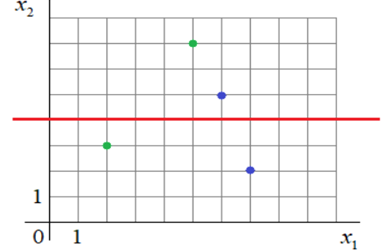

# Лабораторная работа № 2

**Расчет коэффициентов разделяющей линии и вычисление отступа (margin) для объектов разных классов**

Вариант: 2

Студент: ____________________

Группа: ____________________

---

## Исходные данные

По графику (сторона клетки = 1):

| Точка | Цвет | Класс y | x₁ | x₂ |
|---|---|---|---|---|
| x₁ | зеленая | +1 | 2 | 3 |
| x₂ | зеленая | +1 | 5 | 7 |
| x₃ | синяя | −1 | 6 | 5 |
| x₄ | синяя | −1 | 7 | 2 |

Разделяющая линия (красная) — горизонтальная прямая, проходящая через x₂ = 4.

## 1. Расчет весов разделяющей линии

Уравнение линии: ω₁·x₁ + ω₂·x₂ + ω₀ = 0.

Прямая горизонтальная, т.е. не зависит от x₁, значит ω₁ = 0. Тогда
ω₂·x₂ + ω₀ = 0 → x₂ = −ω₀/ω₂ = 4.

Этому условию удовлетворяет любой набор вида ω₂ = k, ω₀ = −4k. Знак k выбирается
из условия на отступы (п. 2): для точек, расположенных дальше от линии, отступ должен
быть положительным, для расположенных ближе — отрицательным.

Расстояния до линии: |x₂ − 4|:

| Точка | Сторона | Расстояние | Относительно линии |
|---|---|---|---|
| (5; 7) зеленая | выше | 3 | дальше (выше синяя на расстоянии 1) |
| (6; 5) синяя | выше | 1 | ближе |
| (2; 3) зеленая | ниже | 1 | ближе (ниже синяя на расстоянии 2) |
| (7; 2) синяя | ниже | 2 | дальше |

Для зеленой точки (5; 7): M = (+1)·(k·7 − 4k) = 3k > 0 ⇒ k > 0. Берем k = 1:

**ω₀ = −4, ω₁ = 0, ω₂ = 1**, уравнение линии: x₂ − 4 = 0.

Вектор весов (с учетом фиктивного признака x₀ = 1): **ω = (−4, 0, 1)**.

## 2. Расчет отступов

Отступ: Mᵢ = yᵢ·⟨ω, xᵢ⟩, где xᵢ = (1, x₁, x₂), ⟨ω, xᵢ⟩ = ω₀ + ω₁·x₁ + ω₂·x₂.

| Точка | y | ⟨ω, x⟩ | M = y·⟨ω, x⟩ |
|---|---|---|---|
| (2; 3) зеленая | +1 | −4 + 0 + 3 = −1 | **−1** |
| (5; 7) зеленая | +1 | −4 + 0 + 7 = 3 | **3** |
| (6; 5) синяя | −1 | −4 + 0 + 5 = 1 | **−1** |
| (7; 2) синяя | −1 | −4 + 0 + 2 = −2 | **2** |

Проверка условия: дальние точки (5; 7) и (7; 2) имеют положительные отступы (3 и 2),
ближние (2; 3) и (6; 5) — отрицательные (−1 и −1). Условие выполнено.

Расчет продублирован программой `lab2.py`.

## 3. Выводы

1. Разделяющая линия для варианта 2 — прямая x₂ = 4, ее коэффициенты
   ω₀ = −4, ω₁ = 0, ω₂ = 1. Коэффициент ω₁ = 0, т.к. линия горизонтальная и признак x₁
   не влияет на классификацию.
2. Веса линии определены с точностью до множителя; знак множителя фиксируется
   условием на знаки отступов.
3. Отступы: M = −1 и M = 3 для зеленых точек, M = −1 и M = 2 для синих.
   Отрицательный отступ означает, что объект классифицирован неверно: точки (2; 3)
   и (6; 5) лежат по «чужую» сторону линии. Модуль отступа пропорционален расстоянию
   до линии (при ‖(ω₁, ω₂)‖ = 1 — равен ему), поэтому точки (2; 3) и (6; 5) с |M| = 1 ближе
   всего к границе, а (5; 7) с M = 3 — наиболее «уверенно» классифицированный объект.
4. Данная линия правильно классифицирует только 2 из 4 объектов — выборка по признаку
   x₂ одной горизонтальной прямой не разделяется.
