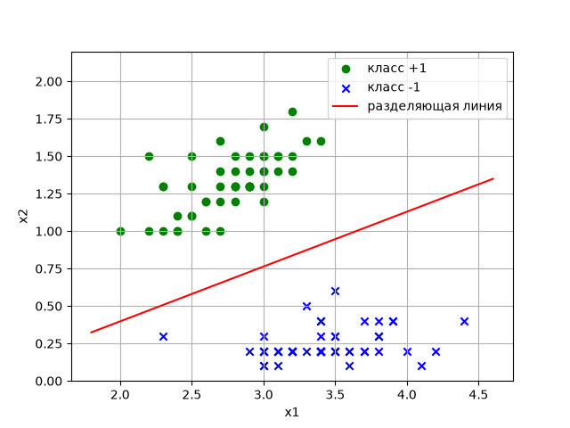

# Лабораторная работа № 3

**Задача бинарной классификации (метод градиентного спуска)**

Вариант: 7 (сигмоидная функция потерь)

Студент: ____________________

Группа: ____________________

---

## Исходные данные

- Обучающая выборка: вариант 7 (100 объектов, по 50 объектов классов +1 и −1).
- Модель: a(x) = sign⟨ω, x⟩, где ω = (ω₀, ω₁, ω₂)ᵀ, x = (1, x₁, x₂)ᵀ.
- Функция потерь: **S(M) = 2·(1 + e^M)⁻¹** — сигмоидная.
- Начальные веса: ω₀ = 0, ω₁ = 0, ω₂ = 1.

## 1. Математические расчеты

### Эмпирический риск и его верхняя оценка

Эмпирический риск — число неверных классификаций:

Q(Xˡ) = Σᵢ [aᵢ ≠ yᵢ] = Σᵢ [Mᵢ < 0], где Mᵢ = yᵢ·⟨ω, xᵢ⟩ — отступ.

Функция [M < 0] ступенчатая, ее градиент равен нулю почти везде, поэтому минимизируется
гладкая верхняя оценка:

Q(Xˡ) ≤ Q̃(ω) = (1/ℓ)·Σᵢ S(Mᵢ) → min по ω

(множитель 1/ℓ не меняет точку минимума, но делает шаг независимым от размера выборки).

Сигмоидная функция действительно ограничивает пороговую сверху: при M < 0 имеем e^M < 1,
откуда S(M) = 2/(1 + e^M) > 1 = [M < 0]; при M ≥ 0 S(M) > 0 = [M < 0].
При M = 0 S = 1, при M → +∞ S → 0, при M → −∞ S → 2.

### Производная функции потерь

S(M) = 2·(1 + e^M)⁻¹

S′(M) = −2·(1 + e^M)⁻²·e^M = **−2e^M / (1 + e^M)²**

S′(M) < 0 при любом M: функция убывает, т.е. чем больше отступ, тем меньше штраф.

### Градиент функционала

Отступ Mᵢ = yᵢ·(ω₀ + ω₁x₁ᵢ + ω₂x₂ᵢ), поэтому ∂Mᵢ/∂ωⱼ = yᵢ·xⱼᵢ (x₀ᵢ = 1).

По правилу дифференцирования сложной функции:

∂Q̃/∂ωⱼ = (1/ℓ)·Σᵢ S′(Mᵢ)·yᵢ·xⱼᵢ

Покоординатно:

- ∂Q̃/∂ω₀ = (1/ℓ)·Σᵢ S′(Mᵢ)·yᵢ
- ∂Q̃/∂ω₁ = (1/ℓ)·Σᵢ S′(Mᵢ)·yᵢ·x₁ᵢ
- ∂Q̃/∂ω₂ = (1/ℓ)·Σᵢ S′(Mᵢ)·yᵢ·x₂ᵢ

### Шаг градиентного спуска

ωⱼ ← ωⱼ − ηⱼ·∂Q̃/∂ωⱼ

Шаги: η₀ = 0.5 (для ω₀ больше, как рекомендовано в задании), η₁ = η₂ = 0.05.
Число итераций: 3000.

## 2. Текст программы

Программа — файл `lab3.py`:

```python
import numpy as np
import matplotlib.pyplot as plt

# data_x, data_y — обучающая выборка варианта 7 (полностью в lab3.py)

x_train = np.array([[1, x1, x2] for x1, x2 in data_x])  # добавляем фиктивный признак x0 = 1
y_train = np.array(data_y)


# сигмоидная функция потерь и ее производная
def loss(m):
    return 2 / (1 + np.exp(m))


def dloss(m):
    return -2 * np.exp(m) / (1 + np.exp(m)) ** 2


w = np.array([0.0, 0.0, 1.0])     # начальные веса w0, w1, w2
lr = np.array([0.5, 0.05, 0.05])  # шаг для w0 больше, для w1, w2 меньше
n_iter = 3000

for i in range(n_iter):
    m = y_train * (x_train @ w)                          # отступы
    grad = (dloss(m) * y_train) @ x_train / len(y_train)  # градиент функционала Q(w)
    w = w - lr * grad

m = y_train * (x_train @ w)
errors = np.sum(m < 0)
print("w =", np.round(w, 4))
print("Функционал Q(w) = %.4f" % loss(m).mean())
print("Число ошибок (эмпирический риск) = %d из %d" % (errors, len(y_train)))

# график: точки классов и разделяющая линия w0 + w1*x1 + w2*x2 = 0
line_x = np.linspace(1.8, 4.6, 2)
line_y = -(w[0] + w[1] * line_x) / w[2]
...
```

## 3. Результаты

Ход обучения:

| Итерация | Q̃(ω) | ω₀ | ω₁ | ω₂ |
|---|---|---|---|---|
| 0 (старт) | 0.7727 | 0 | 0 | 1 |
| 500 | 0.1409 | 1.2440 | −1.4693 | 4.1737 |
| 1000 | 0.0762 | 1.7559 | −1.9306 | 5.3257 |
| 2000 | 0.0411 | 2.2101 | −2.3935 | 6.5335 |
| 3000 | 0.0288 | 2.4311 | −2.6584 | 7.2625 |

Итоговые веса: **ω = (2.4311, −2.6584, 7.2625)**

Разделяющая линия: 2.4311 − 2.6584·x₁ + 7.2625·x₂ = 0, т.е. **x₂ ≈ 0.366·x₁ − 0.335**.

Число неверных классификаций: **0 из 100**. Минимальный отступ M = 1.50 (синяя точка (2.3; 0.3)).



## 4. Выводы

1. Методом градиентного спуска с сигмоидной функцией потерь обучен линейный
   классификатор. Выборка варианта 7 линейно разделима: классы различаются в основном
   по признаку x₂ (у класса +1 x₂ ∈ [1.0; 1.8], у класса −1 x₂ ∈ [0.1; 0.6]). Полученная прямая
   разделяет классы без ошибок: эмпирический риск равен 0.
2. При начальных весах (0, 0, 1) линия x₂ = 0 проходит ниже всех точек, и половина
   выборки (класс −1) классифицирована неверно; функционал Q̃ = 0.77. В процессе обучения
   функционал монотонно убывает до 0.029.
3. Сигмоидная функция ограничена (0 < S < 2), поэтому сильно ошибочные объекты
   (выбросы) дают ограниченный вклад в функционал, а их градиент стремится к нулю.
   Это делает метод устойчивым к выбросам, но функционал невыпуклый, и при неудачном
   начальном приближении спуск может застрять.
4. Когда все отступы становятся положительными и большими, производная S′(M) → 0,
   поэтому обучение замедляется: веса продолжают медленно расти по модулю (линия
   почти не сдвигается, растет только «уверенность» классификатора). Поэтому число
   итераций ограничено.
5. Разные шаги для ω₀ и ω₁, ω₂ оправданы: ω₀ отвечает за параллельный сдвиг прямой,
   а градиент по ω₀ не домножается на значения признаков (x₀ = 1), поэтому без увеличенного
   шага смещение подстраивается гораздо медленнее наклона.
