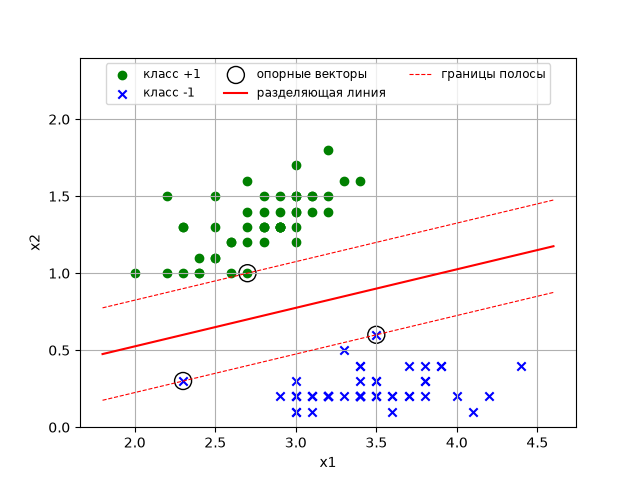

# Лабораторная работа № 4

**Задача классификации (метод опорных векторов)**

Вариант: 7

Студент: ____________________

Группа: ____________________

---

## Исходные данные

- Обучающая выборка: вариант 7 (100 объектов, по 50 объектов классов +1 и −1), та же, что в ЛР3.
- Модель: a(x) = sign(⟨w, x⟩ + w₀) = sign(w₁x₁ + w₂x₂ + w₀).
- Метод: линейный SVM (`sklearn.svm.SVC(kernel="linear")`).

## 1. Метод опорных векторов

### Идея

Если выборка линейно разделима, разделяющих прямых бесконечно много. SVM выбирает ту,
у которой **ширина разделяющей полосы максимальна**, то есть прямую, максимально
удалённую от ближайших объектов обоих классов.

Веса нормируются так, чтобы для ближайших к прямой объектов отступ был равен 1:

Mᵢ = yᵢ·(⟨w, xᵢ⟩ + w₀) ≥ 1, i = 1, …, ℓ.

Тогда полоса задаётся прямыми ⟨w, x⟩ + w₀ = ±1, а её ширина равна **2/‖w‖**.

### Задача оптимизации

Максимизация ширины 2/‖w‖ равносильна минимизации ‖w‖². С учётом возможных ошибок
(мягкий зазор) вводятся переменные ξᵢ ≥ 0 — насколько объект заходит внутрь полосы:

½‖w‖² + C·Σᵢ ξᵢ → min по w, w₀, ξ

при ограничениях yᵢ·(⟨w, xᵢ⟩ + w₀) ≥ 1 − ξᵢ, ξᵢ ≥ 0.

Эквивалентная безусловная запись — минимизация кусочно-линейной функции потерь (hinge loss)
с регуляризацией:

Σᵢ (1 − Mᵢ)₊ + (1/2C)·‖w‖² → min.

Параметр **C** задаёт баланс между шириной полосы и штрафом за нарушения: при большом C
нарушения почти запрещены (жёсткий зазор), при малом C полоса шире, но внутрь неё
допускаются объекты.

### Опорные векторы

Решение двойственной задачи имеет вид w = Σᵢ λᵢ·yᵢ·xᵢ, причём λᵢ ≠ 0 только у объектов,
лежащих на границе полосы или внутри неё. Это **опорные векторы** — только они определяют
положение разделяющей прямой; остальные объекты можно удалить, и решение не изменится.

## 2. Текст программы

Программа — файл `lab4.py`:

```python
import numpy as np
import matplotlib.pyplot as plt
from sklearn.svm import SVC

# data_x, data_y — обучающая выборка варианта 7 (полностью в lab4.py)

x_train = np.array(data_x)
y_train = np.array(data_y)

# сравнение разных значений параметра регуляризации C
print("   C  |   w1      w2      w0   | ошибок | опорных | ширина полосы")
for c in [0.1, 1, 10, 100, 1000]:
    model = SVC(kernel="linear", C=c).fit(x_train, y_train)
    w = model.coef_[0]
    errors = np.sum(model.predict(x_train) != y_train)
    print("%5g | %6.3f  %6.3f  %6.3f | %6d | %7d | %.4f"
          % (c, w[0], w[1], model.intercept_[0], errors, len(model.support_), 2 / np.linalg.norm(w)))

# основная модель: выборка линейно разделима, поэтому берем большое C (жесткий зазор)
model = SVC(kernel="linear", C=1000)
model.fit(x_train, y_train)

w = model.coef_[0]        # w1, w2
w0 = model.intercept_[0]  # свободный член
y_pred = model.predict(x_train)
errors = np.sum(y_pred != y_train)

print("w1 = %.4f, w2 = %.4f, w0 = %.4f" % (w[0], w[1], w0))
print("Ширина разделяющей полосы 2/|w| = %.4f" % (2 / np.linalg.norm(w)))
for i in model.support_:
    print("   x = %s, y = %+d, M = %.4f" % (x_train[i], y_train[i], y_train[i] * (x_train[i] @ w + w0)))
print("Число неверных классификаций = %d из %d" % (errors, len(y_train)))
print("Доля неверных классификаций = %.2f" % (errors / len(y_train)))

# график: точки классов, опорные векторы, разделяющая линия и границы полосы
line_x = np.linspace(1.8, 4.6, 2)
line_y = -(w0 + w[0] * line_x) / w[1]         # w1*x1 + w2*x2 + w0 = 0
margin_up = -(w0 - 1 + w[0] * line_x) / w[1]  # граница полосы для класса +1
margin_dn = -(w0 + 1 + w[0] * line_x) / w[1]  # граница полосы для класса -1
...
```

## 3. Результаты

### Влияние параметра C

| C | w₁ | w₂ | w₀ | Ошибок | Опорных векторов | Ширина полосы 2/‖w‖ |
|---|---|---|---|---|---|---|
| 0.1 | −0.715 | 1.607 | 0.966 | 0 | 37 | 1.1371 |
| 1 | −0.984 | 2.014 | 1.346 | 0 | 8 | 0.8923 |
| 10 | −0.834 | 3.333 | −0.082 | 0 | 3 | 0.5822 |
| 100 | −0.834 | 3.333 | −0.082 | 0 | 3 | 0.5822 |
| 1000 | −0.834 | 3.333 | −0.082 | 0 | 3 | 0.5822 |

Начиная с C = 10 решение не меняется — это решение с жёстким зазором.

### Итоговая модель (C = 1000)

Веса: **w₁ = −0.8336, w₂ = 3.3328, w₀ = −0.0822**

Разделяющая линия: −0.8336·x₁ + 3.3328·x₂ − 0.0822 = 0, т.е. **x₂ ≈ 0.250·x₁ + 0.025**.

Ширина разделяющей полосы: **2/‖w‖ = 0.5822** (расстояние от линии до ближайших объектов 0.291).

Опорные векторы (3 шт.):

| Объект | Класс | Отступ M |
|---|---|---|
| (3.5; 0.6) | −1 | 1.000 |
| (2.3; 0.3) | −1 | 1.000 |
| (2.7; 1.0) | +1 | 1.000 |

Число неверных классификаций: **0 из 100**, доля неверных классификаций: **0.00 (0 %)**.



## 4. Выводы

1. С помощью scikit-learn обучен линейный классификатор методом опорных векторов.
   Выборка варианта 7 линейно разделима, и полученная прямая разделяет классы без ошибок:
   число неверных классификаций 0, доля 0 %.
2. Положение прямой определяется всего тремя опорными векторами — объектами, лежащими
   на границах разделяющей полосы (у всех отступ M = 1). Остальные 97 объектов на решение
   не влияют.
3. В отличие от градиентного спуска в ЛР3, где получалась просто *какая-то* разделяющая
   прямая (x₂ ≈ 0.366·x₁ − 0.335, расстояние до ближайшего объекта 0.195), SVM находит прямую
   с максимальным зазором: расстояние до ближайших объектов 0.291, т.е. в 1.5 раза больше.
   Такая прямая устойчивее к шуму и лучше обобщается на новые объекты. Кроме того, задача
   SVM выпуклая, решение единственное и не зависит от начального приближения и шага.
4. Параметр C регулирует компромисс между шириной полосы и нарушениями: при малом C
   (0.1) полоса почти вдвое шире, но внутрь неё попадает много объектов (37 опорных
   векторов); при C ≥ 10 нарушений нет и получается решение с жёстким зазором.
   Для линейно разделимой выборки разумно брать большое C.
