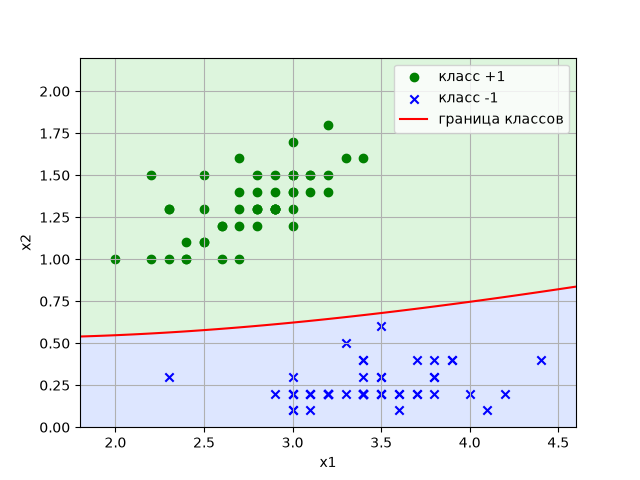
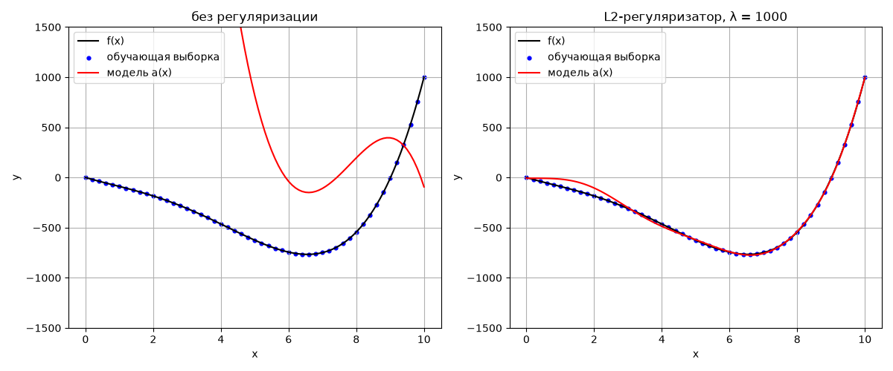

# Лабораторная работа № 5

**Часть 1. Задача классификации (наивный байесовский классификатор)**

**Часть 2 (задание 6). Исследование работы L2-регуляризатора в задачах регрессии**

Вариант: 7

Студент: ____________________

Группа: ____________________

---

# Часть 1. Наивный байесовский классификатор

## Исходные данные

- Обучающая выборка: вариант 7 (100 объектов, по 50 объектов классов +1 и −1), та же, что в ЛР3 и ЛР4.
- Признаки x₁, x₂ считаются независимыми внутри каждого класса и распределёнными
  по нормальному (гауссовскому) закону.

## 1. Математические расчеты

### Байесовское решающее правило

По формуле Байеса апостериорная вероятность класса y для объекта x:

P(y | x) = P(y)·p(x | y) / p(x).

Знаменатель p(x) от класса не зависит, поэтому оптимальный (минимизирующий вероятность
ошибки) классификатор выбирает класс с наибольшим числителем:

**a(x) = argmax_y P(y)·p(x | y)**.

### «Наивное» предположение

Признаки внутри класса независимы, поэтому плотность распадается в произведение
одномерных плотностей:

p(x | y) = p(x₁ | y)·p(x₂ | y).

Каждая одномерная плотность — гауссовская:

p(xⱼ | y) = 1/√(2πσ²ⱼᵧ) · exp(−(xⱼ − μⱼᵧ)² / (2σ²ⱼᵧ)).

Произведение маленьких чисел неудобно считать, поэтому берётся логарифм (он монотонный,
argmax не меняется):

**a(x) = argmax_y [ ln P(y) + Σⱼ ln p(xⱼ | y) ]**,

ln p(xⱼ | y) = −½·ln(2πσ²ⱼᵧ) − (xⱼ − μⱼᵧ)² / (2σ²ⱼᵧ).

### Оценка параметров по выборке

Параметры находятся методом максимального правдоподобия по объектам каждого класса
(ℓᵧ — число объектов класса y):

- априорная вероятность: P(y) = ℓᵧ / ℓ;
- среднее: μⱼᵧ = (1/ℓᵧ)·Σ_{i: yᵢ=y} xⱼᵢ;
- дисперсия: σ²ⱼᵧ = (1/ℓᵧ)·Σ_{i: yᵢ=y} (xⱼᵢ − μⱼᵧ)².

Для варианта 7:

| Класс | P(y) | μ₁ | μ₂ | σ²₁ | σ²₂ | σ₁ | σ₂ |
|---|---|---|---|---|---|---|---|
| −1 | 0.50 | 3.4280 | 0.2460 | 0.14082 | 0.01088 | 0.375 | 0.104 |
| +1 | 0.50 | 2.7700 | 1.3260 | 0.09650 | 0.03832 | 0.311 | 0.196 |

Классы равновероятны, поэтому слагаемое ln P(y) = ln 0.5 одинаково для обоих классов и
на решение не влияет.

### Разделяющая граница

Граница между классами — множество точек, где оценки классов равны:
Γ(x) = [ln P(+1) + Σⱼ ln p(xⱼ | +1)] − [ln P(−1) + Σⱼ ln p(xⱼ | −1)] = 0.

Раскрыв квадраты, получаем

Γ(x) = Σⱼ [ −½(1/σ²ⱼ₊ − 1/σ²ⱼ₋)·xⱼ² + (μⱼ₊/σ²ⱼ₊ − μⱼ₋/σ²ⱼ₋)·xⱼ ] + C,

C = ln(P(+1)/P(−1)) + Σⱼ [ −½·ln(σ²ⱼ₊/σ²ⱼ₋) − μ²ⱼ₊/(2σ²ⱼ₊) + μ²ⱼ₋/(2σ²ⱼ₋) ].

Подставив параметры:

**Γ(x) = −1.631·x₁² + 4.361·x₁ + 32.892·x₂² + 11.998·x₂ − 18.631**

a(x) = +1 при Γ(x) > 0 и −1 при Γ(x) < 0. Дисперсии в классах разные, поэтому граница —
**кривая второго порядка**, а не прямая.

### Пример расчета для объекта x = (3.5; 0.6), класс −1

Это объект, ближайший к границе.

Класс −1:
- ln p(x₁ | −1) = −½·ln(2π·0.14082) − (3.5 − 3.428)²/(2·0.14082) = 0.0612 − 0.0184 = 0.0428;
- ln p(x₂ | −1) = −½·ln(2π·0.01088) − (0.6 − 0.246)²/(2·0.01088) = 1.3413 − 5.7569 = −4.4156;
- оценка: ln 0.5 + 0.0428 − 4.4156 = **−5.0659**.

Класс +1:
- ln p(x₁ | +1) = −½·ln(2π·0.09650) − (3.5 − 2.770)²/(2·0.09650) = 0.2502 − 2.7611 = −2.5110;
- ln p(x₂ | +1) = −½·ln(2π·0.03832) − (0.6 − 1.326)²/(2·0.03832) = 0.7119 − 6.8766 = −6.1647;
- оценка: ln 0.5 − 2.5110 − 6.1647 = **−9.3688**.

−5.0659 > −9.3688, значит a(x) = −1, верно. Γ(x) = −9.3688 + 5.0659 = −4.303.

Апостериорная вероятность: P(+1 | x) = 1/(1 + e^{4.303}) = 0.0133, P(−1 | x) = 0.9867.

## 2. Текст программы

Программа — файл `lab5.py`:

```python
import numpy as np
import matplotlib.pyplot as plt

# data_x, data_y — обучающая выборка варианта 7 (полностью в lab5.py)

x_train = np.array(data_x)
y_train = np.array(data_y)
classes = np.array([-1, 1])

# обучение: априорные вероятности классов, средние и дисперсии признаков в каждом классе
prior = np.array([np.mean(y_train == c) for c in classes])
mean = np.array([x_train[y_train == c].mean(axis=0) for c in classes])
var = np.array([x_train[y_train == c].var(axis=0) for c in classes])  # оценка max правдоподобия (1/n)


# логарифм гауссовской плотности одного признака
def log_gauss(x, mu, s2):
    return -0.5 * np.log(2 * np.pi * s2) - (x - mu) ** 2 / (2 * s2)


# оценки ln P(y) + sum_j ln p(x_j | y) для каждого объекта и каждого класса
def scores(x):
    return np.array([np.log(prior[k]) + log_gauss(x, mean[k], var[k]).sum(axis=1)
                     for k in range(len(classes))]).T


def predict(x):
    return classes[np.argmax(scores(x), axis=1)]


y_pred = predict(x_train)
errors = np.sum(y_pred != y_train)
print("Число неверных классификаций = %d из %d" % (errors, len(y_train)))
print("Доля неверных классификаций = %.2f" % (errors / len(y_train)))

# апостериорные вероятности P(y|x) для 5 объектов, ближайших к границе классов
s = scores(x_train)
post = np.exp(s - s.max(axis=1, keepdims=True))
post = post / post.sum(axis=1, keepdims=True)
...

# график: объекты выборки и граница между классами (где оценки классов равны)
g1, g2 = np.meshgrid(np.linspace(1.8, 4.6, 300), np.linspace(0, 2.2, 300))
grid = np.c_[g1.ravel(), g2.ravel()]
s = scores(grid)
diff = (s[:, 1] - s[:, 0]).reshape(g1.shape)
plt.contourf(g1, g2, diff > 0, levels=1, colors=["#dde6ff", "#ddf5dd"])
plt.contour(g1, g2, diff, levels=[0], colors="red")
plt.scatter(x_train[pos, 0], x_train[pos, 1], c="green", marker="o", label="класс +1")
plt.scatter(x_train[neg, 0], x_train[neg, 1], c="blue", marker="x", label="класс -1")
...
```

## 3. Результаты

Вывод программы:

```
Класс | P(y) | mu1    mu2    | sigma1^2  sigma2^2
  -1  | 0.50 | 3.4280 0.2460 | 0.14082   0.01088
  +1  | 0.50 | 2.7700 1.3260 | 0.09650   0.03832

Число неверных классификаций = 0 из 100
Доля неверных классификаций = 0.00

Объект       | y  | P(-1|x)  P(+1|x) | a(x)
(3.5, 0.6)   | -1 | 0.9867   0.0133   | -1
(3.3, 0.5)   | -1 | 0.9996   0.0004   | -1
(2.3, 0.3)   | -1 | 1.0000   0.0000   | -1
(3.4, 0.4)   | -1 | 1.0000   0.0000   | -1
(3.4, 0.4)   | -1 | 1.0000   0.0000   | -1
```

Число неверных классификаций: **0 из 100**, доля неверных классификаций: **0.00 (0 %)**.

Для проверки параметры и предсказания сверены с `sklearn.naive_bayes.GaussianNB`:
средние, дисперсии и число ошибок совпадают.

На графике закрашены области, которые классификатор относит к классу +1 (зелёная) и −1
(синяя), красная кривая — граница Γ(x) = 0.



## 4. Выводы

1. Реализован наивный байесовский классификатор с гауссовскими плотностями признаков.
   Обучение сводится к вычислению по выборке априорных вероятностей, средних и дисперсий
   признаков в каждом классе — без итераций и подбора шага.
2. На выборке варианта 7 классификатор не допускает ошибок: число неверных
   классификаций 0, доля 0 %. Классы хорошо разделяются по признаку x₂: разность средних
   1.326 − 0.246 = 1.08 — это 10 стандартных отклонений класса −1 и 5.5 — класса +1.
3. Дисперсии признаков в классах различаются (σ²₂ для класса +1 в 3.5 раза больше,
   чем для класса −1), поэтому граница получается квадратичной кривой, выгнутой в
   сторону класса −1 с меньшим разбросом. При равных дисперсиях граница была бы прямой.
4. В отличие от ЛР3 и ЛР4, классификатор выдаёт не только класс, но и апостериорную
   вероятность P(y | x). Ближайший к границе объект (3.5; 0.6) отнесён к классу −1 с
   вероятностью 0.987, остальные — практически с вероятностью 1.
5. Предположение о независимости признаков — упрощение: на самом деле внутри класса +1
   x₁ и x₂ заметно коррелированы (коэффициент корреляции 0.66, у класса −1 — 0.23). Здесь это не мешает, так как классы далеко друг от
   друга, но на перекрывающихся классах «наивность» может давать ошибки и завышенную
   уверенность в вероятностях.

---

# Часть 2 (задание 6). Исследование работы L2-регуляризатора в задачах регрессии

## Исходные данные

- Функция (вариант 7): **f(x) = x⁴ − 10x³ + 20x² − 100x**, x ∈ [0; 10] с шагом 0.1 (101 отсчёт).
- Модель — полином 13-й степени: **a(x) = w₀ + Σᵢ₌₁¹³ wᵢxⁱ** (14 весов).
- Обучающая выборка — отсчёты с чётными индексами: (x₀, f(x₀)), (x₂, f(x₂)), …, (x₁₀₀, f(x₁₀₀)),
  ℓ = 51 объект. Отсчёты с нечётными индексами (50 шт.) в обучении не участвуют.

## 1. Математические выкладки

### Модель в матричном виде

Модель линейна по весам: a(x) = ⟨w, φ(x)⟩, где φ(x) = (1, x, x², …, x¹³) — вектор признаков,
w = (w₀, w₁, …, w₁₃)ᵀ. Для всей выборки:

X = (φ(x₀); φ(x₂); …; φ(x₁₀₀)) — матрица 51×14, строка i = (1, xᵢ, xᵢ², …, xᵢ¹³),
Y = (f(x₀), f(x₂), …, f(x₁₀₀))ᵀ — вектор целевых значений.

Прогнозы модели на выборке: a = Xw.

### Квадратичная функция потерь

Q(w) = ½·Σᵢ (yᵢ − a(xᵢ))² = ½·‖Y − Xw‖² → min по w.

### Минимум без регуляризации

Градиент функционала:

∇Q(w) = −Xᵀ(Y − Xw) = XᵀXw − XᵀY.

Q(w) — выпуклая квадратичная функция, её минимум — точка, где градиент равен нулю
(к этой же точке сходится градиентный алгоритм):

XᵀXw = XᵀY ⇒ **w* = (XᵀX)⁻¹XᵀY** (нормальное уравнение).

### Минимум с L2-регуляризатором

К функционалу добавляется штраф за большие веса:

Q_λ(w) = ½·‖Y − Xw‖² + (λ/2)·‖w‖² → min по w, λ > 0.

∇Q_λ(w) = XᵀXw − XᵀY + λw = 0 ⇒ (XᵀX + λI)w = XᵀY ⇒ **w* = (XᵀX + λI)⁻¹XᵀY**,

I — единичная матрица 14×14.

### Почему без регуляризации модель «разваливается»

Элементы XᵀX — суммы Σxᵢ^{j+k}, j, k = 0…13. При x до 10 они лежат в диапазоне от 51
(Σ1) до 2.4·10²⁶ (Σx²⁶). Число обусловленности

**cond(XᵀX) ≈ 1.9·10²⁸**,

а относительная точность чисел double ε ≈ 2.2·10⁻¹⁶. Ошибка обращения матрицы
порядка cond·ε ≈ 10¹², т.е. (XᵀX)⁻¹ вычисляется с полностью неверными знаками:
веса получаются огромными и случайными, и полином не проходит ни через обучающие,
ни через остальные точки.

Добавка λI увеличивает все собственные значения матрицы на λ. Маленькие собственные
значения, из-за которых матрица почти вырождена, перестают быть близкими к нулю, и
решение становится устойчивым. Одновременно штраф ‖w‖² не даёт весам расти.

## 2. Текст программы

Программа — файл `task6.py`:

```python
import numpy as np
import matplotlib.pyplot as plt


# Вариант 7: исследуемая функция
def f(x):
    return x ** 4 - 10 * x ** 3 + 20 * x ** 2 - 100 * x


x = np.arange(0, 10.05, 0.1)  # x ∈ [0; 10] с шагом 0.1, 101 отсчет
y = f(x)
N = 13                        # степень полинома

X_all = np.array([[a ** n for n in range(N + 1)] for a in x])  # строки (1, x, x^2, ..., x^13)
X = X_all[::2]                # обучающая выборка: четные индексы x0, x2, ..., x100
Y = y[::2]


def mse(a, b):
    return np.mean((a - b) ** 2)


# 1) без регуляризации: w = (X^T X)^-1 X^T Y
w = np.linalg.inv(X.T @ X) @ X.T @ Y
a = X_all @ w                 # прогноз на всем диапазоне

# 2) с L2-регуляризатором: w = (X^T X + lambda*I)^-1 X^T Y, подбор lambda
for lam_i in [0.01, 1, 10, 100, 1000, 10000, 100000]:
    w_i = np.linalg.inv(X.T @ X + lam_i * np.eye(N + 1)) @ X.T @ Y
    ...

lam = 1000
w_l2 = np.linalg.inv(X.T @ X + lam * np.eye(N + 1)) @ X.T @ Y
a_l2 = X_all @ w_l2

# проверка: тот же МНК без явного обращения X^T X (через SVD матрицы X)
w_ls = np.linalg.lstsq(X, Y, rcond=None)[0]
...
# графики: f(x), обучающие точки и модель без регуляризации / с L2
```

## 3. Результаты

Вывод программы:

```
Отсчетов всего: 101, в обучающей выборке: 51
Число обусловленности X^T X = 1.92e+28

Без регуляризации:
  w = [ 2.9519e+04 -1.0249e+04  3.0812e+02  3.5732e+02 -8.0003e+01  8.7099e+00
 -5.5361e-01  3.3486e-02 -4.6316e-03  6.0613e-04 -5.0521e-05  2.6492e-06
 -8.1093e-08  1.0948e-09]
  MSE на обучающих отсчетах = 106315091.90, на остальных = 99413287.86

  lambda  | MSE обуч. | MSE остальн. |   |w|
     0.01 | 4703158.13 |   4474786.84 | 5.85e+03
        1 |  73156.52 |     66346.13 | 1.08e+03
       10 |   5009.31 |      4853.63 | 1.63e+02
      100 |    353.83 |       304.69 | 7.19e+01
     1000 |   1202.73 |      1225.15 | 9.26e+00
    10000 |   2844.48 |      2895.38 | 1.80e+00
   100000 |   4173.00 |      4256.93 | 3.65e+00

С L2-регуляризатором, lambda = 1000:
  w = [-7.3381e+00  5.6466e-01 -1.4669e+00 -2.7201e+00 -3.1025e+00 -2.7732e+00
 -4.3352e-01  1.9304e+00 -9.1800e-01  2.0874e-01 -2.6960e-02  2.0288e-03
 -8.3165e-05  1.4390e-06]
  MSE на обучающих отсчетах = 1202.73, на остальных = 1225.15
  Число обусловленности X^T X + lambda*I = 1.25e+25

Проверка (lstsq, без обращения X^T X): MSE на обучающих = 0.0628, на остальных = 0.0504
```

Значения функции на отрезке — от −766 до 1000.

| Модель | MSE на обучающих отсчётах | MSE на остальных отсчётах | ‖w‖ |
|---|---|---|---|
| без регуляризации | 1.06·10⁸ | 9.94·10⁷ | 3.1·10⁴ |
| L2, λ = 1000 | 1203 | 1225 | 9.3 |



Слева — модель без регуляризации: она сильно расходится с функцией в отсчётах, не
участвующих в выборке (и даже в обучающих). Справа — модель с L2-регуляризатором:
она практически совпадает с f(x) на всём диапазоне, кроме участка x < 3, где отклонение
доходит до 89 (на остальном участке — не больше 23).

## 4. Выводы

1. Без регуляризации веса полинома 13-й степени, найденные по формуле
   w = (XᵀX)⁻¹XᵀY, получаются огромными (w₀ ≈ 3·10⁴), и прогнозы модели сильно
   расходятся с целевыми значениями — средняя квадратичная ошибка ~10⁸ при значениях
   функции порядка 10³.
2. Причина — плохая обусловленность матрицы XᵀX (cond ≈ 2·10²⁸): степени x до 13
   при x ≤ 10 отличаются на десятки порядков, и обращение матрицы в арифметике
   double теряет всю точность. Это подтверждает проверка: тот же метод наименьших
   квадратов, решённый без явного обращения XᵀX (`lstsq`), даёт ошибку 0.05, потому что
   f(x) — сам полином 4-й степени и точно представим моделью. Из-за той же
   неустойчивости конкретные числа для λ = 0 и малых λ могут отличаться на другом
   компьютере или при другом способе построения матрицы X; качественная картина
   при этом сохраняется.
3. L2-регуляризатор (добавка λI) делает задачу устойчивой: при λ = 1000 норма весов
   уменьшается с 3·10⁴ до 9, ошибка падает на 5 порядков (до ~1200, т.е. ~35 в среднем при
   размахе функции 1766), и модель одинаково хорошо работает на обучающих и на
   остальных отсчётах.
4. Слишком большой λ ухудшает модель: при λ = 10⁴…10⁵ ошибка снова растёт, потому что
   регуляризатор прижимает к нулю и нужные веса (недообучение). λ — гиперпараметр,
   его подбирают по ошибке на отсчётах, не участвующих в обучении (таблица выше).
5. Регуляризатор штрафует все веса одинаково, хотя влияние wᵢ на прогноз зависит от
   масштаба xⁱ: коэффициенты при младших степенях (w₀, w₁) малы по влиянию и сильнее
   всего «сжимаются». Поэтому регуляризованная модель хуже всего около x = 0. Обычно
   это решают нормировкой признаков перед обучением и не регуляризуют w₀.
